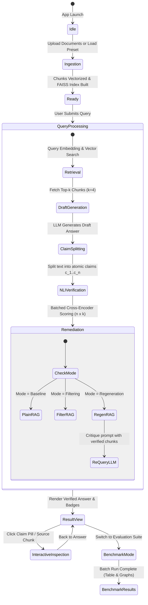

# Application Flow (APP_FLOW.md)

## Project: VerifyRAG
**Description:** End-to-end navigational flows, state transitions, interaction triggers, and error-handling paths.

---

## 1. High-Level Flowchart

---

## 2. Step-by-Step User Journey & Phases

### Phase 1: Document Ingestion Flow
1. **Initial Screen:** User lands on the main dashboard.
2. **Action:** User chooses one of two paths:
   * **Path A:** Drag-and-drops custom files (`.pdf`, `.txt`, `.md`) into the sidebar uploader.
   * **Path B:** Selects a pre-indexed academic benchmark preset (e.g., *Quantum Error Correction Papers*, *Biomedical QA Corpus*, or *CS Systems Architecture Notes*).
3. **System Transition:**
   * Text extraction $\rightarrow$ Recursive chunking ($500$ chars, $50$ overlap).
   * SentenceTransformers embeds chunks.
   * FAISS builds in-memory L2 / Cosine index.
4. **UI Response:** A success toast triggers: `"Indexed 48 chunks across 2 documents (Embedding time: 380ms)"`.

---

### Phase 2: Query Submission Flow
1. **Action:** User types a question into the query input field (or clicks an example prompt).
2. **Parameter Selection (Sidebar / Inline Pills):**
   * **Mode Selector:**
     * `[Plain RAG]` (Raw generation, no post-filtering)
     * `[VerifyRAG: Filter]` (Strips unsupported statements)
     * `[VerifyRAG: Regenerate]` (Re-writes strictly using verified premises)
   * **Threshold Sliders:**
     * Entailment Threshold ($\tau_{\text{entail}}$, default `0.70`)
     * Contradiction Threshold ($\tau_{\text{contra}}$, default `0.60`)
3. **Trigger:** User presses `Enter` or clicks `"Execute Verified Query"`.

---

### Phase 3: Pipeline Processing & Reactive Feedback
The UI disables the query input and displays an animated 5-stage progress indicator:

1. **Step 1 (Retrieval):**
   * *Status:* Query embedded; top-$k$ nearest neighbors fetched from FAISS.
   * *Telemetry:* `Retrieval: 38ms`.
2. **Step 2 (Draft Generation):**
   * *Status:* Generator LLM produces an initial fluent draft response.
   * *Telemetry:* `LLM Draft: 790ms`.
3. **Step 3 (Claim Decomposition):**
   * *Status:* Sentence boundary tokenization + proposition parsing extracts $N$ atomic claims.
   * *Telemetry:* `Extracted 5 claims in 14ms`.
4. **Step 4 (Batched NLI Inference):**
   * *Status:* Cross-Encoder DeBERTa processes $N \times K$ candidate pairs.
   * *Telemetry:* `NLI Batched: 290ms`.
5. **Step 5 (Remediation & Final Assembly):**
   * *Status:* Executes selected remediation strategy (Filter out non-entailed claims OR re-synthesize via LLM).
   * *Telemetry:* `Total Pipeline: 1.82s`.

---

### Phase 4: Result Inspection & Interaction
Once processing terminates, the UI transitions to the **Three-Panel Inspection View**:

#### Panel A: The Final Answer Box
* The verified answer is displayed with embedded citation pills (e.g., `[Chunk 2]`).
* Hovering over citation `[Chunk 2]` creates a glowing cyan border around the corresponding chunk in the Source Inspector.
* If **Filtering Mode** was selected, an optional toggle `"Show Removed Claims"` reveals removed/flagged claims in strike-through red font with a contradiction warning tooltip.

#### Panel B: Claim Breakdown Accordion
* Each decomposed claim is presented in a card:
  * **Claim 1:** `"Surface codes detect syndrome errors using X and Z stabilizers."`
  * **Verdict Badge:** `[ SUPPORTED ]` (Emerald Green)
  * **Supporting Source:** `Chunk #2 (Similarity: 0.89, Entailment: 94.2%)`
  * **Claim 2:** `"They require zero physical qubit overhead."`
  * **Verdict Badge:** `[ CONTRADICTED ]` (Crimson Red)
  * **Reason:** Directly contradicts Chunk #1: *"Surface codes incur significant physical-to-logical qubit overhead."*

#### Panel C: Telemetry & Quality HUD
* **Faithfulness Meter:** Gauge displaying $\text{Faithfulness} = 50\% \rightarrow 100\%$ (Post-remediation).
* **Hallucination Suppression Rate:** `1 Contradiction Caught & Neutralized`.
* **Latency Profile:** Interactive mini stacked bar chart (Retrieval, LLM, NLI, Remediation).

---

### Phase 5: Academic Benchmark Mode (Guide & Defense Presentation)
1. **Trigger:** User clicks `"Run Comparative Benchmark"` tab.
2. **Action:** Selects a test dataset of $15$ known trick questions (questions designed to lure plain LLMs into hallucination).
3. **Execution:** The system runs all three modes sequentially in background threads.
4. **Output Matrix:** Automatically compiles a clean publication-ready table:

| Mode | Total Claims | Entailed | Contradicted | Faithfulness | Avg Latency |
| :--- | :--- | :--- | :--- | :--- | :--- |
| **Plain RAG** | 68 | 44 (64.7%) | 14 (20.6%) | **64.7%** | **0.85s** |
| **VerifyRAG (Filter)** | 48 | 44 (91.7%) | 0 (0.0%) | **91.7%** | **1.22s** |
| **VerifyRAG (Regenerate)** | 52 | 50 (96.2%) | 0 (0.0%) | **96.2%** | **1.94s** |

---

## 3. Edge Cases & Error Recovery Paths

| Failure Scenario | System Behavior | User Notification |
| :--- | :--- | :--- |
| **Empty Vector DB** | User queries before uploading any document. | Inline prompt: *"Please upload at least one document or select an academic preset first."* |
| **Irrelevant / OOD Query** | Similarity scores for all top-$k$ chunks fall below $0.30$. | System alerts: *"Context contains insufficient information to answer this query reliably."* |
| **Total Hallucination** | LLM draft produces 0 entailed claims ($100\%$ unsupported). | In Filter Mode: Displays *"No claims could be verified from source documents."* In Regen Mode: Falls back to *"The provided documents do not state..."* |
| **NLI Model Out of Memory (OOM)** | Batch size exceeds available VRAM during large document test. | Dynamic fallback: Splits batch into sub-batches of 8 pairs or automatically switches to CPU execution mode. |
| **LLM Provider API Timeout** | OpenAI / Groq API takes $>10\text{s}$. | Graceful retry once with exponential backoff; if persistent, prompts fallback to local Ollama instance. |
