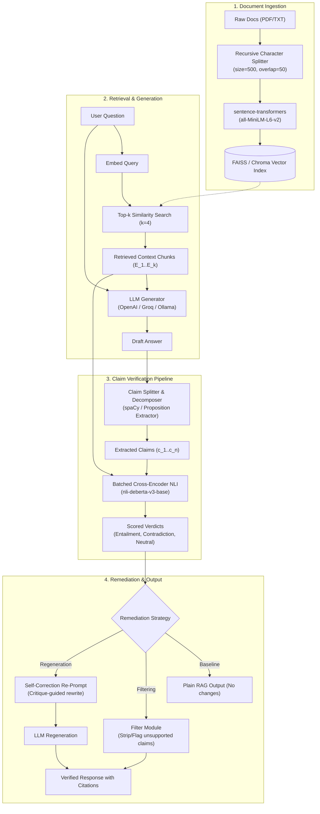

# Technical Requirements Document (TRD)

## Project: VerifyRAG
**Architecture:** Modular Asynchronous RAG with Cross-Encoder NLI Verification Pipeline  
**Runtime:** Python 3.10+  
**Target Environment:** Local Workstation (Windows / Linux) with optional CUDA acceleration  

---

## 1. System Architecture Diagram



---

## 2. Core Technology Stack

| Layer | Component | Specification / Library | Justification |
| :--- | :--- | :--- | :--- |
| **Language** | Python | 3.10 or 3.11 | Standard for NLP/DL ecosystem with strong type hinting support. |
| **Document Processing** | PyPDF / pdfplumber | `pypdf>=4.0` | Reliable text extraction from research papers and PDFs. |
| **Chunking** | LangChain / Custom Splitter | `RecursiveCharacterTextSplitter` | Preserves semantic paragraph and sentence boundaries. |
| **Embeddings** | SentenceTransformers | `all-MiniLM-L6-v2` or `bge-small-en-v1.5` | Fast, lightweight (384-dim), strong retrieval benchmarks. |
| **Vector Database** | FAISS / Chroma | `faiss-cpu` / `chromadb` | Millisecond retrieval; FAISS runs entirely local with zero cloud dependencies. |
| **Generator LLM** | Modular Adapter | OpenAI `gpt-4o-mini` / Groq `llama-3.3-70b` / Ollama `llama3:8b` | Dynamic fallback from high-speed API to 100% offline local LLM. |
| **Claim Splitter** | spaCy + Rule Engine | `spacy (en_core_web_sm)` | Deterministic, ultra-fast sentence and clause tokenization. |
| **Verification (NLI)** | Hugging Face Transformers | `cross-encoder/nli-deberta-v3-base` | SOTA performance on MNLI/FEVER; cross-attention between chunk and claim. |
| **Backend API** | FastAPI + Uvicorn | `fastapi>=0.110`, `uvicorn>=0.28` | Async endpoints, automatic OpenAPI schema documentation. |
| **Frontend UI** | Streamlit or Next.js | `streamlit>=1.35` | Research-grade interactive UI with reactive sliders, tabs, and chunk visualizers. |

---

## 3. Mathematical & Algorithmic Formulation

### 3.1 Claim Extraction & Pairing
Given a generated draft answer $D$, the text is partitioned into a set of atomic claims:
$$C = \{c_1, c_2, \dots, c_n\}$$
Given $K$ retrieved context chunks $E = \{e_1, e_2, \dots, e_k\}$, we form a Cartesian product of candidate pairs:
$$\mathcal{P} = \{(c_i, e_j) \mid 1 \le i \le n, 1 \le j \le k\}$$

### 3.2 Batched NLI Cross-Encoder Scoring
The cross-encoder receives tokenized pair $[e_j; c_i]$ where $e_j$ is the premise and $c_i$ is the hypothesis.
$$\mathbf{z}_{ij} = \text{DeBERTa}(\text{Premise}=e_j, \text{Hypothesis}=c_i) \in \mathbb{R}^3$$
$$\mathbf{p}_{ij} = \text{Softmax}(\mathbf{z}_{ij}) = \big[ P(\text{Contradiction}), P(\text{Neutral}), P(\text{Entailment}) \big]$$

For each claim $c_i$, we compute its maximum entailment and contradiction scores across all chunks:
$$\hat{E}_i = \max_{j \in [1, k]} P(\text{Entailment} \mid e_j, c_i), \quad j^*_i = \arg\max_{j \in [1, k]} P(\text{Entailment} \mid e_j, c_i)$$
$$\hat{C}_i = \max_{j \in [1, k]} P(\text{Contradiction} \mid e_j, c_i)$$

### 3.3 Classification Decision Rule
$$\text{Verdict}(c_i) = \begin{cases}
\text{SUPPORTED (Citing } e_{j^*_i}), & \text{if } \hat{E}_i \ge \tau_{\text{entail}} \\
\text{CONTRADICTED}, & \text{else if } \hat{C}_i \ge \tau_{\text{contra}} \\
\text{UNSUPPORTED (Neutral)}, & \text{otherwise}
\end{cases}$$
*(Default thresholds: $\tau_{\text{entail}} = 0.70$, $\tau_{\text{contra}} = 0.60$)*

---

## 4. API Specification (FastAPI)

### 4.1 `POST /api/v1/documents/upload`
* **Request:** `multipart/form-data` with files (`.pdf`, `.txt`).
* **Response:**
```json
{
  "document_id": "doc_8f1a23",
  "filename": "quantum_computing.pdf",
  "num_chunks": 42,
  "status": "indexed"
}
```

### 4.2 `POST /api/v1/query`
* **Request Body:**
```json
{
  "query": "What are the primary error correction mechanisms in surface codes?",
  "top_k": 4,
  "mode": "regeneration", 
  "entailment_threshold": 0.70
}
```
* **Response Body:**
```json
{
  "query": "What are the primary error correction...",
  "mode": "regeneration",
  "draft_answer": "Surface codes detect errors using stabilizer measurements...",
  "verified_answer": "Surface codes detect syndrome errors using X and Z stabilizers [Chunk 2].",
  "claims": [
    {
      "claim_id": 1,
      "text": "Surface codes detect syndrome errors using X and Z stabilizers.",
      "verdict": "SUPPORTED",
      "best_chunk_id": 2,
      "confidence": 0.942,
      "scores": {"entailment": 0.942, "neutral": 0.045, "contradiction": 0.013}
    },
    {
      "claim_id": 2,
      "text": "They guarantee zero physical qubit overhead.",
      "verdict": "CONTRADICTED",
      "best_chunk_id": 1,
      "confidence": 0.881,
      "scores": {"entailment": 0.012, "neutral": 0.107, "contradiction": 0.881}
    }
  ],
  "metrics": {
    "total_claims": 2,
    "supported_claims": 1,
    "unsupported_claims": 0,
    "contradicted_claims": 1,
    "faithfulness_score": 50.0,
    "latency_breakdown_ms": {
      "retrieval": 42.1,
      "draft_generation": 810.5,
      "claim_split": 15.2,
      "nli_verification": 310.4,
      "regeneration": 790.1,
      "total": 1968.3
    }
  }
}
```

### 4.3 `POST /api/v1/benchmark/run`
* Runs an automated test suite comparing Plain RAG vs. VerifyRAG (Filtering) vs. VerifyRAG (Regeneration) over a test evaluation dataset.
* Returns comparative JSON with aggregated Faithfulness, Precision, and Latency.

---

## 5. Repository Directory Structure

```text
VerifyRAG/
├── PRD.md
├── TRD.md
├── UI_UX_DESIGN_BRIEF.md
├── APP_FLOW.md
├── brain.md
├── .env.example
├── .gitignore
├── requirements.txt
├── data/
│   ├── sample_docs/          # Sample PDFs/textbooks for testing
│   └── evaluation/           # Benchmark question-answer datasets
├── src/
│   ├── __init__.py
│   ├── config.py             # App configurations, thresholds, model names
│   ├── ingestion/
│   │   ├── __init__.py
│   │   ├── parser.py         # PDF and text extraction
│   │   ├── chunker.py        # Recursive chunking
│   │   └── vector_store.py   # FAISS / Chroma wrapper
│   ├── pipeline/
│   │   ├── __init__.py
│   │   ├── generator.py      # LLM Draft generation (OpenAI/Groq/Ollama)
│   │   ├── claim_splitter.py # Sentence & proposition decomposition
│   │   ├── verifier.py       # Batched Cross-Encoder DeBERTa NLI engine
│   │   ├── remediator.py     # Filtering and Regeneration algorithms
│   │   └── orchestrator.py   # Full VerifyRAG pipeline execution
│   ├── evaluation/
│   │   ├── __init__.py
│   │   ├── metrics.py        # Faithfulness, Precision, Latency calculators
│   │   └── benchmark.py      # Automated baseline comparison suite
│   └── api/
│       ├── __init__.py
│       ├── app.py            # FastAPI application
│       └── schemas.py        # Pydantic v2 data models
└── frontend/
    └── app.py                # Streamlit interactive UI application
```

---

## 6. Optimization & Performance Engineering

1. **Batched NLI Inference:** Instead of $N \times K$ sequential model forward passes, vectorize all $(c_i, e_j)$ pairs into a single tensor batch:
   $$\text{Batch Size} = N \times K \le 32$$
   This reduces DeBERTa inference latency from $\sim 2.5\text{s}$ down to $\sim 250\text{ms}$ on a modern GPU, or $< 1.2\text{s}$ on multi-threaded CPU.
2. **Dynamic Truncation:** Pass only top-$K$ chunks ($K \le 4$) to the NLI model rather than the full document.
3. **In-Memory Caching:** Cache embeddings and NLI results for repeated claim queries to optimize benchmark throughput.
